<div align="center">

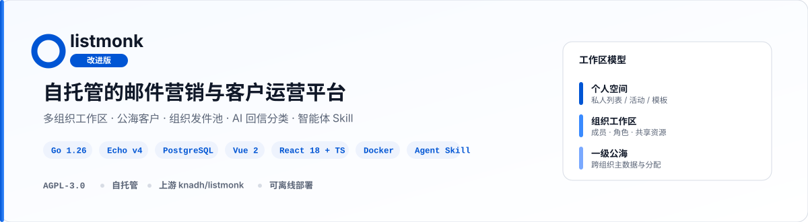

<br />

**自托管的邮件营销与客户运营平台 · 多组织工作区 · 公海客户 · 组织发件池 · AI 回信分类**

[](https://go.dev)
[](https://echo.labstack.com)
[](https://www.postgresql.org)
[](https://v2.vuejs.org)
[](https://react.dev)
[](https://docs.docker.com/compose/)
[](LICENSE)
[](docs/swagger/)
[](frontend/cypress/e2e)
[](internal/migrations)
[](i18n)

[亮点](#highlights) · [功能概览](#features) · [界面导览](#screenshots) · [系统架构](#architecture) · [快速开始](#quickstart) · [技术文档](#techdocs) · [文档索引](#index)

</div>

---

> **项目定位**
>
> 本仓库 **不是** 官方 `knadh/listmonk` 的原版镜像，也不代表上游项目。
> 它在保留基础邮件营销能力的前提下，围绕**多组织协作、公海客户、组织级投递、权限隔离与企业运维**做了独立扩展。
> 使用前请以本仓库的代码、迁移和文档为准。

## 目录

- [亮点速览](#highlights)
- [为什么选择改进版](#why)
- [功能概览](#features)
  - [营销活动全流程](#f-campaign)
  - [私域客户与公海客户](#f-customer)
  - [组织、工作区与权限](#f-org)
  - [发件池与 AI 回信](#f-delivery)
  - [媒体库与模板](#f-media)
- [界面导览](#screenshots)
- [系统架构](#architecture)
- [快速开始](#quickstart)
- [技术栈](#stack)
- [项目结构](#structure)
- [技术文档](#techdocs)
- [文档索引](#index)
- [参与贡献](#contributing)
- [许可证](#license)

<a id="highlights"></a>

## 亮点速览

<table>
<tr>
<td width="33%" valign="top">
<h3>多组织工作区</h3>
个人空间与组织工作区并列，成员身份（member / manager）与系统角色互相独立，跨空间克隆与安全迁移。
</td>
<td width="33%" valign="top">
<h3>公海客户</h3>
一级公海主数据 + 组织公海分配，跨组织受众去重、按组织顺序轮转投递，邮箱按权限自动脱敏。
</td>
<td width="33%" valign="top">
<h3>组织发件池</h3>
把成员 SMTP 组成发送池逐封轮询，持久化游标保证重启和并发都不丢进度，发送来源可追溯。
</td>
</tr>
<tr>
<td width="33%" valign="top">
<h3>AI 回信分类</h3>
非破坏 IMAP 扫描 + OpenAI 兼容网关，自动识别退订 / 投诉 / 其他，明确的退订才触发黑名单。
</td>
<td width="33%" valign="top">
<h3>58 项细粒度权限</h3>
16 个业务分组、资源所有权与工作区三重边界，个人 API Key 拥有独立前缀白名单。
</td>
<td width="33%" valign="top">
<h3>失败定向补发</h3>
失败历史不可改写，可按分类筛选，只对勾选的失败客户重新投递，不影响已完成部分。
</td>
</tr>
</table>

<a id="why"></a>

## 为什么选择改进版

| 维度 | 上游官方版定位 | 本改进版 |
| :--- | :--- | :--- |
| **工作区模型** | 单实例邮件列表管理 | 个人空间 + 组织工作区 + 工作区切换与组织生命周期 |
| **客户数据** | 传统名单与联系人 | 私域客户 + 公海主数据 + 组织公海分配 + 邮箱脱敏 |
| **公海营销** | 未提供该业务模型 | 一级公海跨组织受众、联系人去重、组织顺序轮转、统一回件邮箱 |
| **发件路由** | 常规 SMTP 投递 | 组织成员 SMTP 池轮询、持久化游标、额度联动、发送来源快照 |
| **发送治理** | 失败只累加计数 | 失败明细可查、可按分类筛选，仅对勾选的失败客户补发 |
| **回信处理** | 未展开 AI 回信流程 | 非破坏 IMAP 扫描、OpenAI 兼容分类、转发、去重队列与审计 |
| **权限与审计** | 工作区与动作级边界较少 | 58 项细粒度权限、API Key scope、脱敏边界、业务审计日志 |

<a id="features"></a>

## 功能概览

<a id="f-campaign"></a>

### 营销活动全流程

- **可视化编辑器**：独立打包的 React 18 + TypeScript 邮件编辑器，同时支持富文本、HTML、Markdown 与纯文本。
- **发送治理**：每日额度与续发时间、错误阈值自动暂停，以及**失败客户定向补发** —— 失败历史不可改写，按分类筛选后仅对勾选的客户重投。
- **追踪与报表**：打开 / 点击追踪、唯一互动、地理分布，按活动或跨活动统计。

<table>
<tr>
<td width="50%">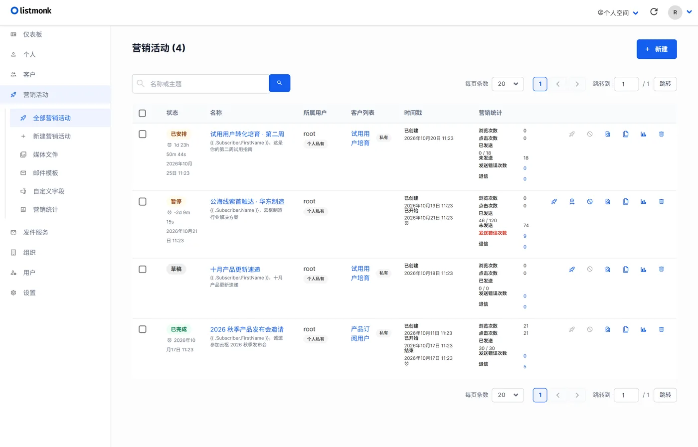</td>
<td width="50%">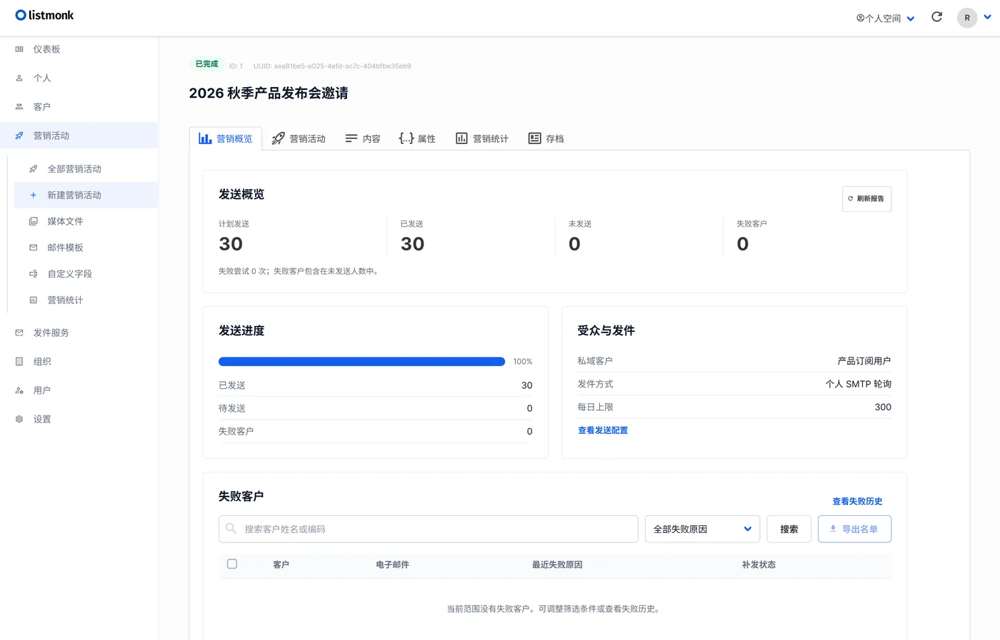</td>
</tr>
<tr>
<td align="center"><sub><b>活动列表</b> · 状态、送达、错误与统计一屏可见</sub></td>
<td align="center"><sub><b>营销概览</b> · 计划 / 已发送 / 未发送 / 失败客户</sub></td>
</tr>
<tr>
<td width="50%">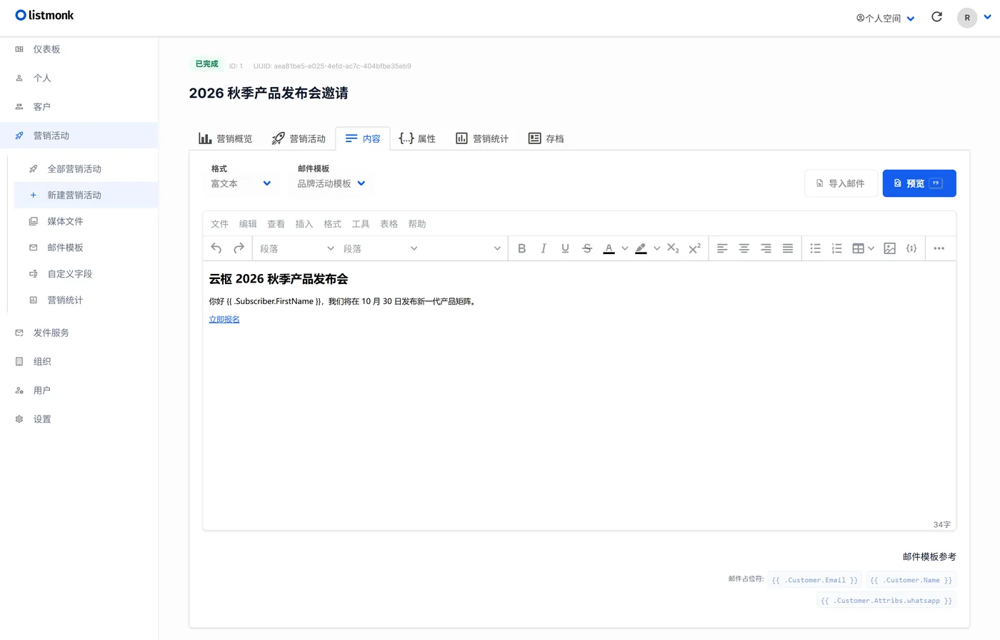</td>
<td width="50%">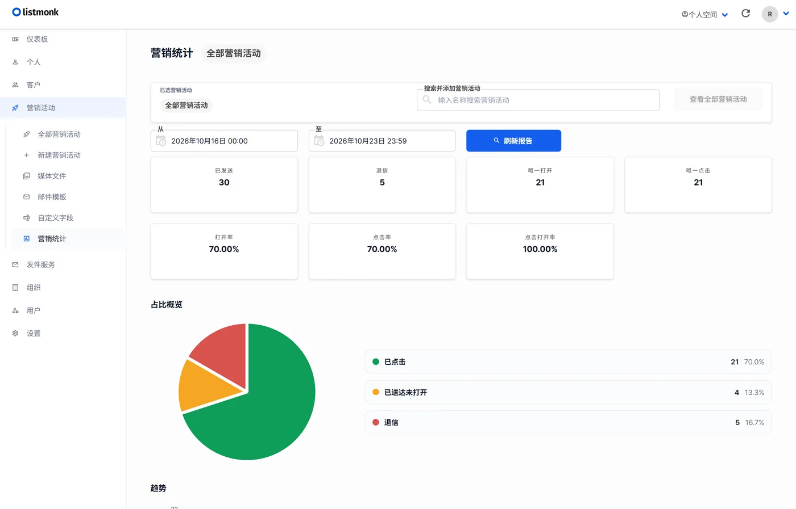</td>
</tr>
<tr>
<td align="center"><sub><b>内容编辑</b> · 富文本 / HTML / Markdown / 可视化</sub></td>
<td align="center"><sub><b>营销统计</b> · 打开率、点击率、占比与趋势</sub></td>
</tr>
</table>

<a id="f-customer"></a>

### 私域客户与公海客户

管理端把普通客户统一称为 **私域客户**，把平台主数据称为 **公海客户**，二者在左侧菜单中并列：

| 入口 | 路径 | 职责 |
| :--- | :--- | :--- |
| 公海客户 | `/admin/pool` | 汇总所有可访问公海下的客户，支持筛选、批量分配与导出 |
| 公海客户列表 | `/admin/pool-lists` | 只管理一级公海与组织公海分配（父子树 + 分配工作台） |
| 私域客户 | `/admin/customers` | 私域客户主数据、标签、订阅状态与批量操作 |
| 私域客户列表 | `/admin/customer-lists` | 普通私域列表，不能创建公海 |

- **邮箱脱敏**：无 `customers:sensitive_read` 权限时，列表、导出、API 与收件人报告一致脱敏。
- **公海去重**：同一身份重复导入更新既有记录，不产生重复客户；不同身份的空白编码不冲突。
- **分配工作台**：左侧目标组织、右侧客户 / 分配信息 / 操作记录，使用 `expected_version` 乐观锁。
- **公海黑名单**：主数据与组织分配均可拉黑 / 恢复，删除只解除关系，不破坏平台主数据。

<table>
<tr>
<td width="50%">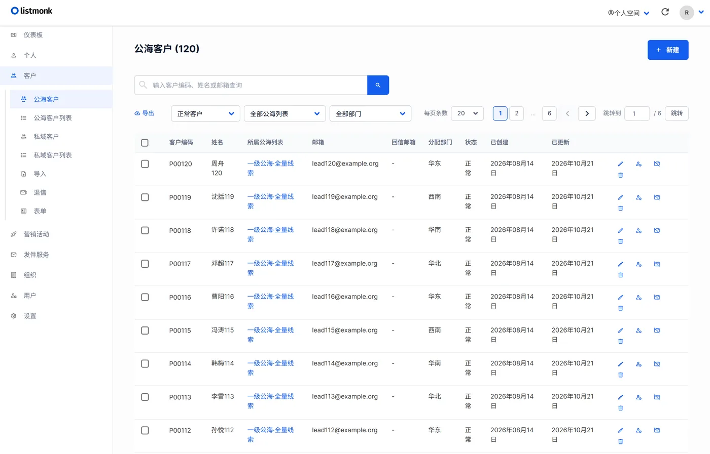</td>
<td width="50%">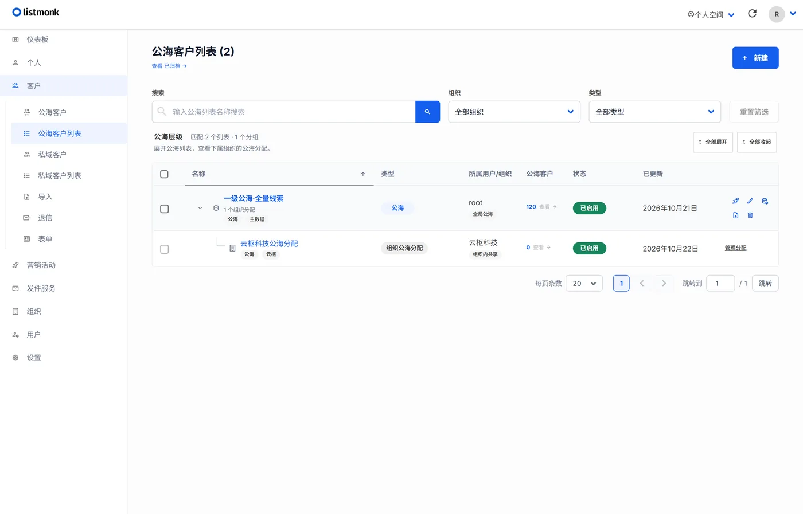</td>
</tr>
<tr>
<td align="center"><sub><b>公海客户</b> · 服务端分页、部门筛选、批量操作</sub></td>
<td align="center"><sub><b>公海列表</b> · 一级公海与组织分配父子树</sub></td>
</tr>
<tr>
<td width="50%">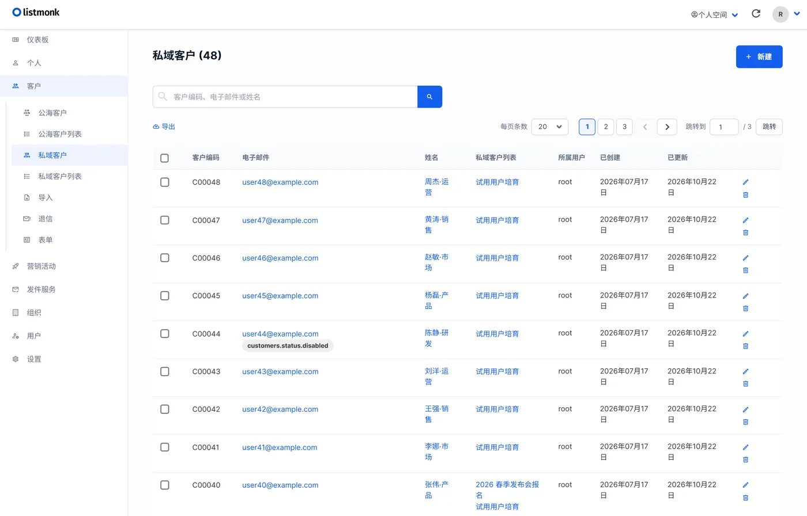</td>
<td width="50%">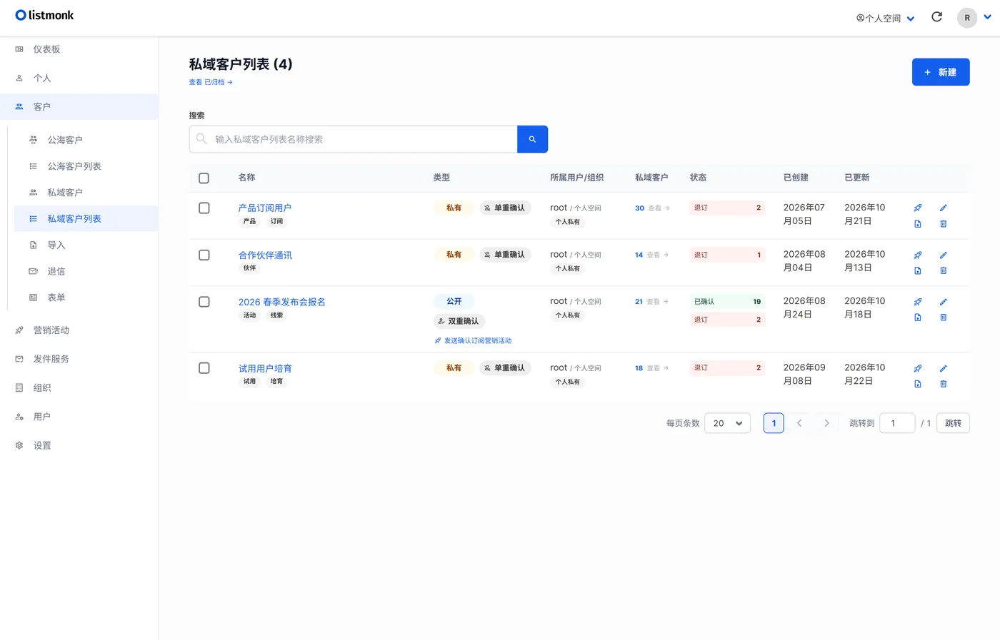</td>
</tr>
<tr>
<td align="center"><sub><b>私域客户</b> · 客户编码、订阅状态与所属列表</sub></td>
<td align="center"><sub><b>私域列表</b> · 列表类型、确认方式与人数</sub></td>
</tr>
</table>

<p align="center">
  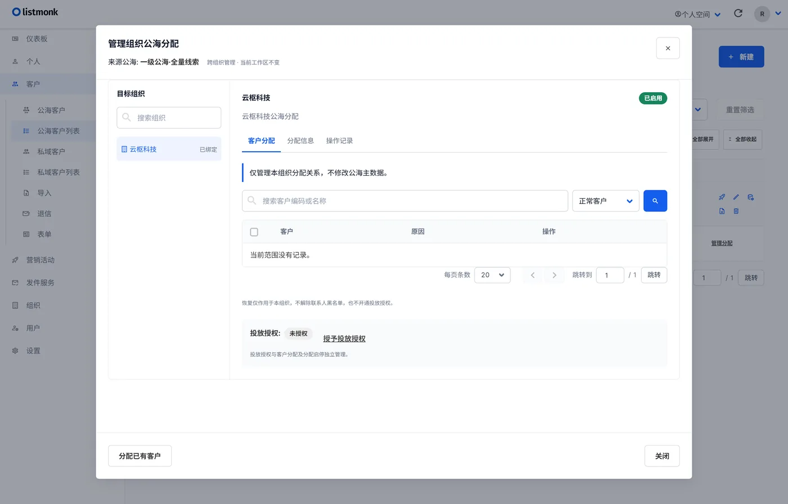
  <br />
  <sub><b>组织公海分配工作台</b> · 跨组织管理而不切换当前工作区，客户分配 / 分配信息 / 操作记录分页签</sub>
</p>

<a id="f-org"></a>

### 组织、工作区与权限

- **双层身份**：组织成员身份（`member` / `manager`）决定能进入哪些工作区，系统角色决定拥有哪些功能权限，二者独立。
- **细粒度权限**：`permissions.json` 定义 **16 个业务分组、58 项权限**，角色表单按业务模块展示，不预设岗位角色。
- **资源归属**：列表、活动、模板、素材、邮箱均带 `owner_user_id` / `organization_id` / `visibility`，支持跨空间克隆与安全迁移。
- **业务审计**：写入、发送、导出、黑名单等动作登记业务审计，可按工作区与目标筛选。
- **API Key**：个人 Bearer Key 拥有独立前缀白名单，不因角色权限提升而越界。

<table>
<tr>
<td width="50%">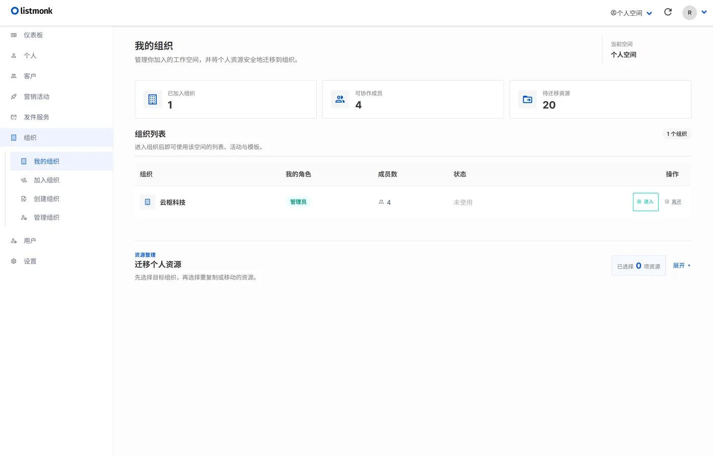</td>
<td width="50%">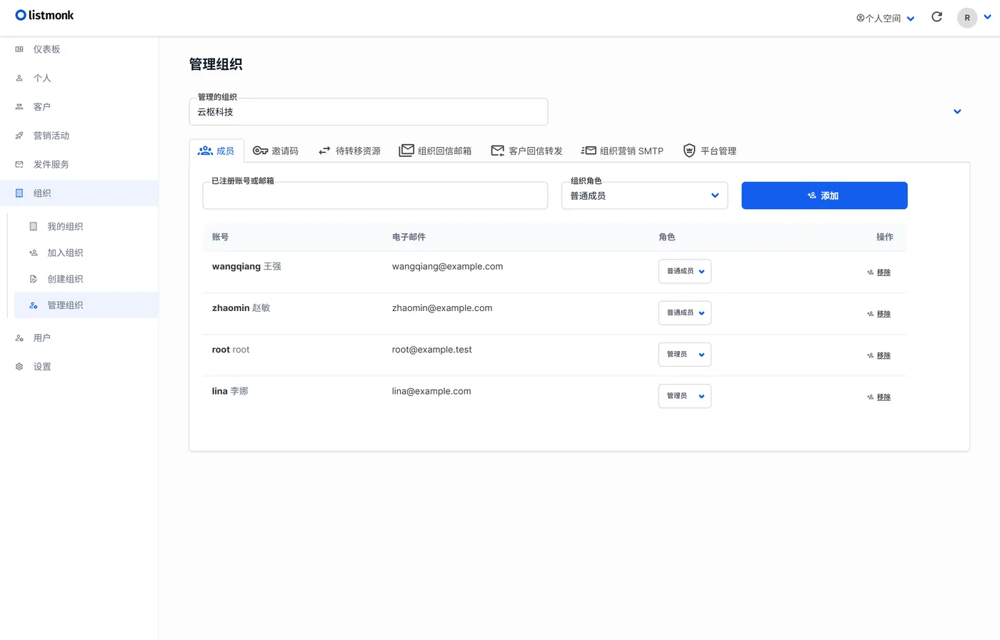</td>
</tr>
<tr>
<td align="center"><sub><b>我的组织</b> · 个人资源可迁移进组织空间</sub></td>
<td align="center"><sub><b>管理组织</b> · 成员、邀请码、资源、回信邮箱、SMTP、平台管理</sub></td>
</tr>
<tr>
<td width="50%">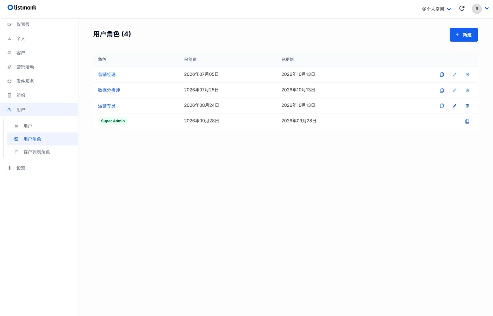</td>
<td width="50%">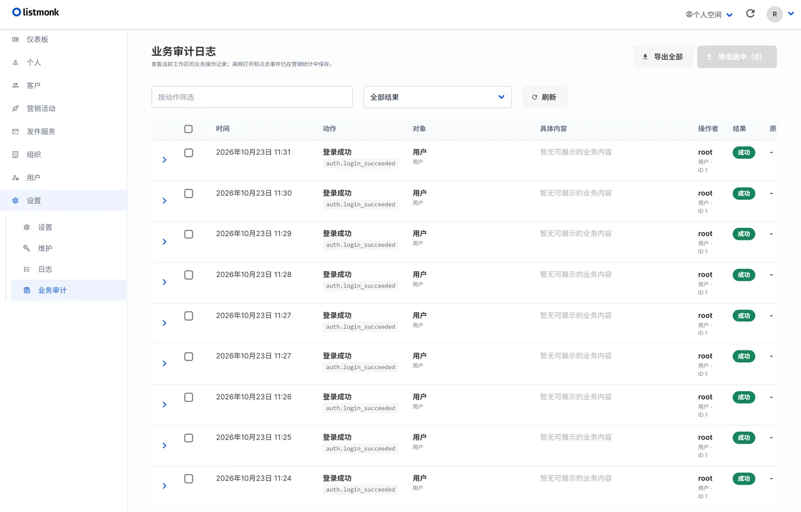</td>
</tr>
<tr>
<td align="center"><sub><b>用户角色</b> · 按 16 个业务分组授权，不预设岗位</sub></td>
<td align="center"><sub><b>业务审计</b> · 工作区内业务动作留痕与导出</sub></td>
</tr>
</table>

<a id="f-delivery"></a>

### 发件池与 AI 回信

**组织 SMTP 池**：把组织内启用的成员 SMTP 组成发送池，按组织游标逐封轮询，服务重启或并发发送都不会丢失进度。

**平台级公海营销**：拥有 `campaigns:public_pool_send` 的用户可以把一级公海作为跨组织受众 —— 汇总所有活跃组织的公海分配并对重复联系人去重，按持久化的组织顺序轮转投递，使用目标组织的统一回件邮箱作为 Reply-To，并在发送前检查回件邮箱、SMTP 与额度是否就绪。

**入站回信 AI 分类**：基于 OpenAI 兼容接口的非破坏性 IMAP 扫描，对退订、垃圾 / 滥用投诉、产品投诉和其他回信分类，持久化队列去重并支持重试。

> 明确的退订会将客户退订并加入黑名单；垃圾投诉同步记录为退信；其余结果保留为审计记录，**不会直接修改客户**。

<table>
<tr>
<td width="50%">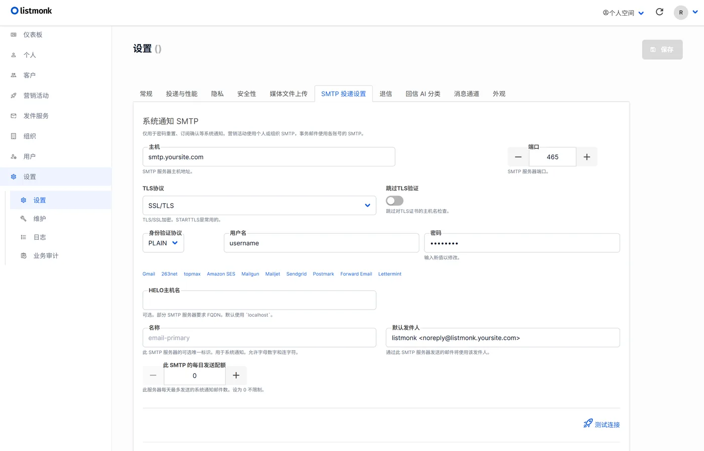</td>
<td width="50%">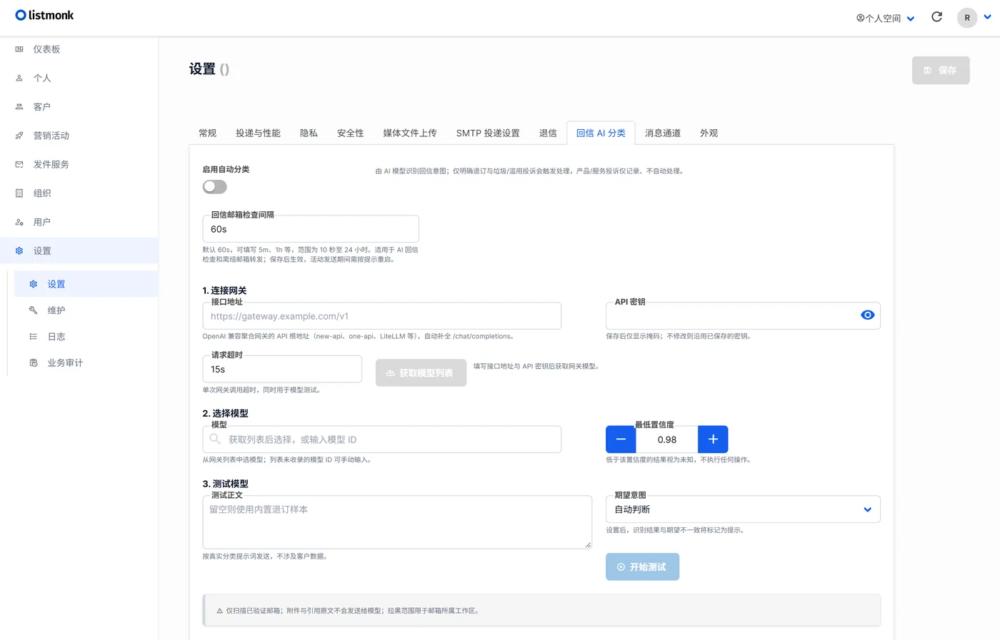</td>
</tr>
<tr>
<td align="center"><sub><b>SMTP 投递</b> · 个人 / 组织来源与每日限额</sub></td>
<td align="center"><sub><b>回信 AI</b> · 网关、模型、置信度与实测</sub></td>
</tr>
<tr>
<td width="50%">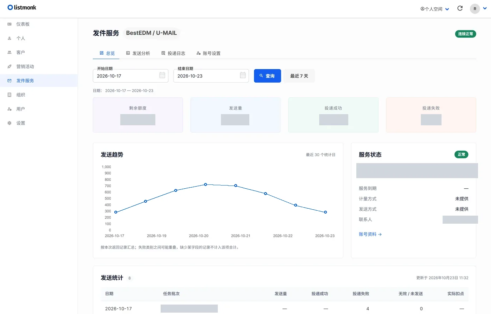</td>
<td width="50%">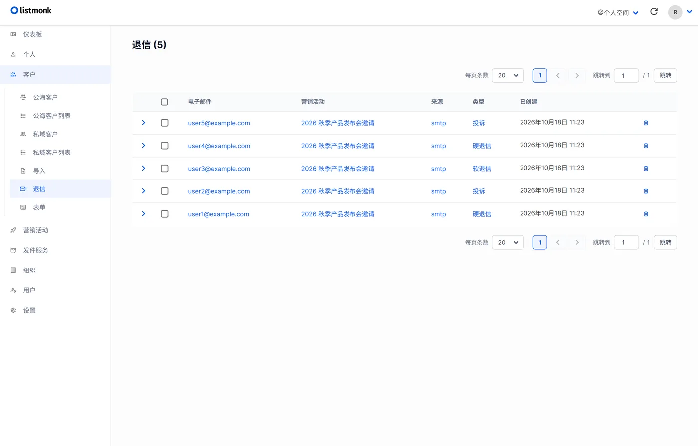</td>
</tr>
<tr>
<td align="center"><sub><b>发件服务</b> · 上游发送分析、失败地址与日志</sub></td>
<td align="center"><sub><b>退信</b> · 软 / 硬退信与投诉、黑名单联动</sub></td>
</tr>
</table>

<a id="f-media"></a>

### 媒体库与模板

- **全平台只读分类**：超级管理员可按「组织 → 所有者」两列渐进筛选浏览，但不产生写入。
- **媒体引用校验**：保存、审计、发送三处共用同一 HTML 引用扫描器；发送 worker 发现依赖缺失会立即暂停并归还待发送收件人。
- **模板体系**：活动模板（HTML / 可视化）、事务模板、存档模板，共享范围与 `assets:share` 权限绑定。

<table>
<tr>
<td width="50%">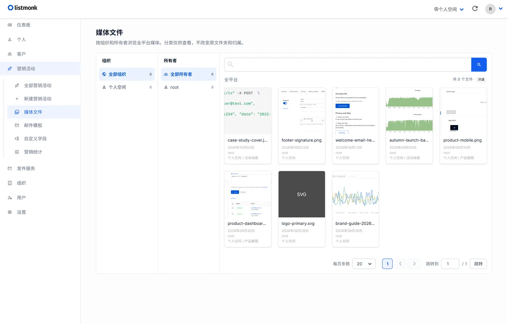</td>
<td width="50%">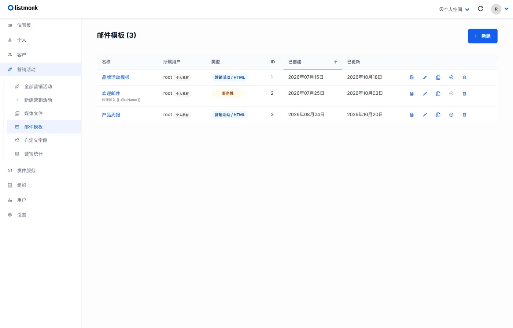</td>
</tr>
<tr>
<td align="center"><sub><b>媒体库</b> · 组织 / 所有者筛选、文件夹与缩略图</sub></td>
<td align="center"><sub><b>邮件模板</b> · 活动 / 事务模板与共享范围</sub></td>
</tr>
</table>

<a id="screenshots"></a>

## 界面导览

> 全部截图取自本仓库代码运行的演示实例（中文界面、演示数据）。

<table>
<tr>
<td width="50%">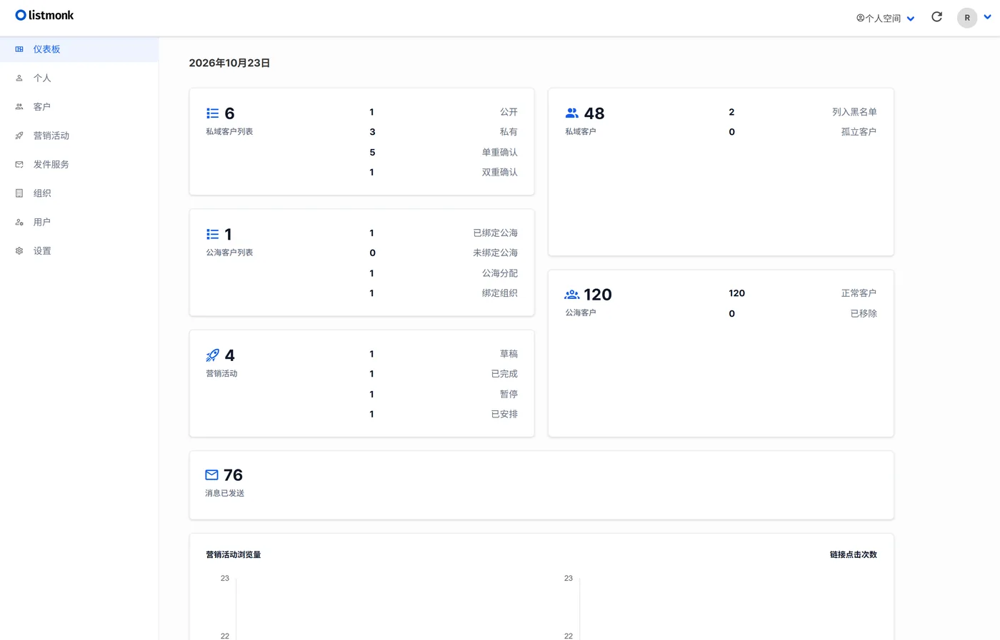</td>
<td width="50%">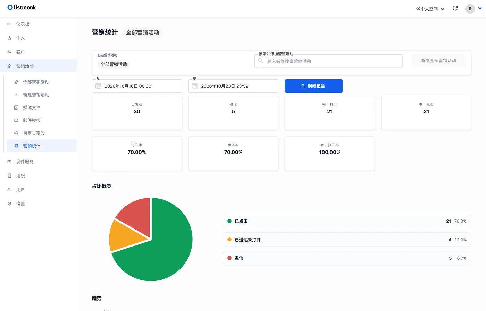</td>
</tr>
<tr>
<td align="center"><sub><b>仪表板</b> · 私域 / 公海 / 活动 / 发送量概览</sub></td>
<td align="center"><sub><b>营销统计</b> · 跨活动的送达、打开与点击趋势</sub></td>
</tr>
<tr>
<td width="50%">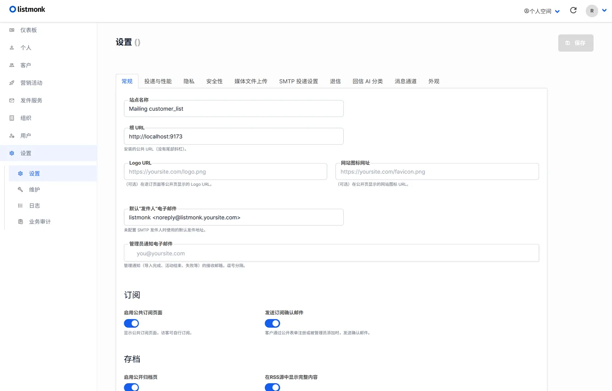</td>
<td width="50%">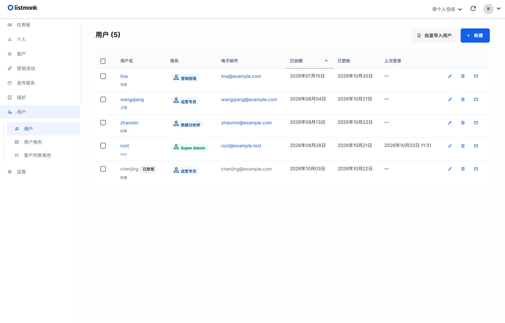</td>
</tr>
<tr>
<td align="center"><sub><b>设置</b> · 常规、性能、隐私、安全、媒体、SMTP、退信、回信、外观</sub></td>
<td align="center"><sub><b>用户</b> · 成员与角色绑定关系</sub></td>
</tr>
</table>

<p align="center">
  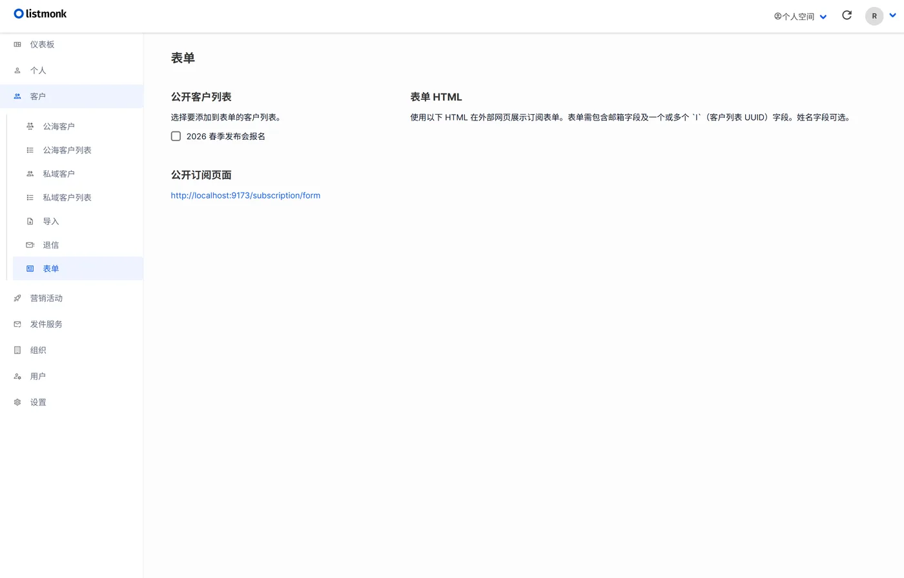
  <br />
  <sub><b>公开订阅表单</b> · 选择列表，复制 HTML 嵌入外部站点</sub>
</p>

<a id="architecture"></a>

## 系统架构

<p align="center">
  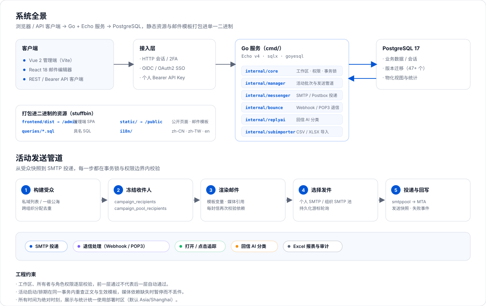
</p>

**一条活动邮件的旅程**：构建受众 → 冻结收件人快照 → 渲染邮件 → 选择发件通道 → 投递与回写。每一步都在事务锁与权限边界内校验，前一层通过不代表后一层自动通过。

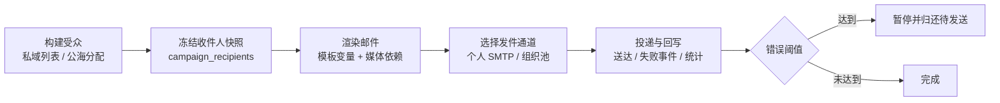

### 工作区与资源边界

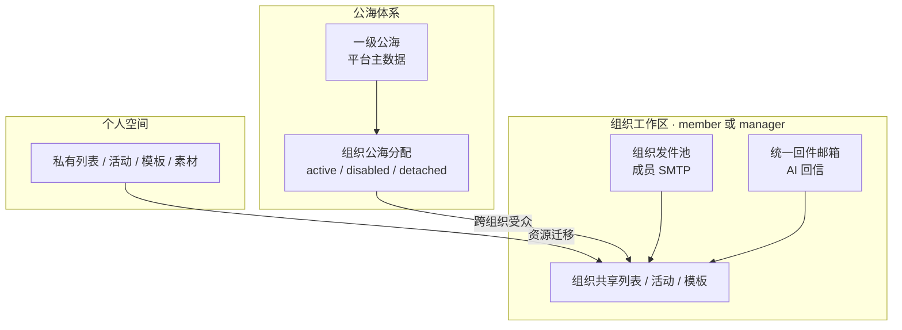

<details>
<summary><b>展开：模块职责与工程不变量</b></summary>

<br />

| 路径 | 职责 |
| :--- | :--- |
| `cmd/` | 程序入口、Echo 路由、HTTP 处理器、初始化与配置加载 |
| `internal/core/` | 领域操作、工作区查询、资源授权、带锁的事务写入 |
| `internal/manager/` | 活动调度、批次管道、发送错误与媒体依赖守卫 |
| `internal/messenger/` | SMTP / Postbox 投递与连接池 |
| `internal/bounce/` | Webhook 与 POP3 退信处理 |
| `internal/replyai/` | 回信 AI 分类网关与租约 |
| `internal/subimporter/` | CSV / XLSX 批量导入 |
| `models/` `queries/` `schema.sql` `internal/migrations/` | 数据模型、具名 SQL、初始结构与版本迁移 |
| `frontend/` | Vue 2 管理端（视图、组件、设计令牌、Cypress 端到端测试） |
| `frontend/email-builder/` | 独立的 React 18 + TypeScript 可视化邮件编辑器 |
| `static/` `i18n/` | 公开页面、邮件模板、静态资源与语言包 |
| `dev/` `deploy/` `.github/` `Jenkinsfile` | 本地容器、离线部署包、Actions 与 Jenkins 流水线 |

**关键不变量**

- **认证边界**：请求携带 `Authorization` 时始终按显式 API 凭据认证，不会静默回退到 Cookie 会话。
- **首次引导**：`Core.FirstTimeSetup` 在事务内取 `pg_advisory_xact_lock`，并发调用只会有一个成功。
- **OIDC 绑定**：仅在 provider 明确断言 `email_verified: true` 时绑定账号，缺失或为 `false` 一律拒绝。
- **统一时区**：`internal/tz` 是唯一解析入口，数据库会话、日志、导出与前端展示使用同一部署时区。
- **媒体依赖**：受保护媒体 URL、相对图片地址、blob / data 图片与无对应 MIME 部件的 CID 不得进入 SMTP。

详见 [工程架构指南](docs/ARCHITECTURE.md) 与 [工程状态记录](docs/harness/README.md)。

</details>

<a id="quickstart"></a>

## 快速开始

### Docker Compose（推荐）

根目录 `docker-compose.yml` 的默认镜像名仍是 `listmonk/listmonk:latest`，直接使用会启动**官方镜像**。要运行本仓库代码，请先构建本地镜像：

```shell
git clone https://github.com/Ubanillx/listmonk.git
cd listmonk
make dist
docker build -t listmonk-enhanced:latest .
```

创建 `docker-compose.override.yml` 切换到本地镜像：

```yaml
services:
  app:
    image: listmonk-enhanced:latest
```

启动数据库与应用，首次启动可通过环境变量创建最高管理员：

```shell
LISTMONK_ADMIN_USER=admin LISTMONK_ADMIN_PASSWORD='请替换为强密码' docker compose up -d
```

默认访问地址为 <http://localhost:39100>。Compose 会自动初始化数据库，并在升级镜像时运行幂等迁移。

> **注意**：生产环境请先修改数据库凭据、站点地址、时区与上传目录，并在升级前备份 PostgreSQL。

### 二进制安装

```shell
git clone https://github.com/Ubanillx/listmonk.git
cd listmonk
make dist

./listmonk --new-config     # 生成配置并填写 PostgreSQL 连接信息
./listmonk --install        # 初始化数据库；升级用 ./listmonk --upgrade --yes
./listmonk                  # 启动服务，访问 http://localhost:9000
```

> **提示**：请勿使用上游发行版替代本项目二进制，否则公海、组织与 AI 回信等改进功能不会生效。

### 本地开发

默认开发拓扑为「Docker 中间件 + 主机 Go + 主机 Node.js」，在三个 PowerShell 终端依次运行：

```powershell
pwsh -File .\dev\start-middleware.ps1   # PostgreSQL / MailHog / Adminer
pwsh -File .\dev\start-backend.ps1      # 迁移 + Go + Air 热更新
pwsh -File .\dev\start-frontend.ps1     # Vite 热更新
```

| 服务 | 地址 |
| :--- | :--- |
| 管理端（Vite） | <http://localhost:8181/admin/> |
| Go API | <http://localhost:9173> |
| PostgreSQL | `localhost:5437` |
| MailHog | <http://localhost:8265> |

| 命令 | 用途 |
| :--- | :--- |
| `make build` | 编译 Go 后端为 `./listmonk` |
| `make build-frontend` | 构建管理端与邮件编辑器 |
| `make dist` | 构建并把前后端资源打包进二进制 |
| `make test` | 运行 Go 测试（`go test ./...`） |
| `cd frontend && yarn lint` | 检查 Vue / JavaScript 代码 |
| `cd frontend && yarn cypress run` | 运行 49 个 Cypress 端到端测试 |

<a id="stack"></a>

## 技术栈

<table>
<tr><td><b>后端</b></td><td>Go 1.26.1 · Echo v4 · sqlx / goyesql · Koanf · PostgreSQL 17 · stuffbin 单二进制打包</td></tr>
<tr><td><b>认证</b></td><td>PostgreSQL 持久化会话 · 传统 API 令牌 · 个人 Bearer API Key · OIDC / OAuth2 · TOTP 2FA</td></tr>
<tr><td><b>前端</b></td><td>Vue 2.7 · Vue Router · Vuex · Axios · Buefy 0.9 / Bulma · Vite 5 · Yarn 1</td></tr>
<tr><td><b>邮件编辑器</b></td><td>React 18 · TypeScript · MUI · Vite · Zod</td></tr>
<tr><td><b>投递与消息</b></td><td>smtppool v2 · go-pop3 · go-imap · 多消息通道（Webhook / 即时通讯）</td></tr>
<tr><td><b>数据能力</b></td><td>Excelize（Excel 导入导出）· goldmark（Markdown）· GeoIP2（打开地理分布）· sprig（模板函数）</td></tr>
<tr><td><b>运维与测试</b></td><td>Docker Compose · systemd · GoReleaser · Go testing · ESLint · Cypress 15</td></tr>
</table>

<a id="structure"></a>

## 项目结构

```text
listmonk/
├── cmd/                       # 入口、路由、HTTP 处理器、初始化
├── internal/
│   ├── core/                  # 领域操作、工作区、授权、事务写入
│   ├── manager/               # 活动调度与发送管道
│   ├── messenger/             # SMTP / 消息通道投递
│   ├── bounce/                # Webhook / POP3 退信
│   ├── replyai/               # 回信 AI 分类
│   ├── subimporter/           # CSV / XLSX 导入
│   └── migrations/            # 76 个版本迁移
├── models/  queries/  schema.sql
├── frontend/                  # Vue 2 管理端 + Cypress 端到端测试
│   └── email-builder/         # React 18 可视化邮件编辑器
├── static/  i18n/             # 公开页面、邮件模板、语言包
├── docs/                      # 用户文档、架构指南、API 规范、readme 配图
├── dev/  deploy/  .github/    # 本地容器、部署包、CI 流水线
└── Makefile  Dockerfile  permissions.json
```

<a id="techdocs"></a>

## 技术文档

- **[工程架构指南](docs/ARCHITECTURE.md)** — 模块边界、工作区、权限、发送与部署约束，是贡献者理解代码的入口。
- **[用户文档](docs/docs/content/index.md)** — 安装、配置、活动、客户、组织与 API 使用说明（MkDocs）。
- **[API 规范](docs/swagger/)** — 可导入 Swagger / OpenAPI 工具的接口定义。
- **[API 使用文档](docs/docs/content/apis/apis.md)** — 端点、字段、权限与错误码说明。
- **[业务权限说明](docs/docs/content/business-permissions.md)** — 显示名称、稳定权限 ID、依赖与升级语义。
- **[模板语法](docs/docs/content/templating.md)** — Go 模板、订阅者变量与事务模板。
- **[工程状态记录](docs/harness/README.md)** — TODO、计划、状态、技术债务与业务逻辑不变量。
- **[文档地图](docs/README.md)** — 网站、用户文档、API 规范与工程记录的入口。

<a id="index"></a>

## 文档索引

| 主题 | 文档 |
| :--- | :--- |
| 安装与升级 | [安装](docs/docs/content/installation.md) · [配置](docs/docs/content/configuration.md) · [升级](docs/docs/content/upgrade.md) |
| 核心概念 | [概念](docs/docs/content/concepts.md) · [模板语法](docs/docs/content/templating.md) · [查询与分群](docs/docs/content/querying-and-segmentation.md) |
| 客户与公海 | [客户 API](docs/docs/content/apis/customers.md) · [公海 API](docs/docs/content/apis/pools.md) · [列表 API](docs/docs/content/apis/customer-lists.md) |
| 营销活动 | [活动 API](docs/docs/content/apis/campaigns.md) · [媒体 API](docs/docs/content/apis/media.md) · [模板 API](docs/docs/content/apis/templates.md) |
| 组织与权限 | [组织 API](docs/docs/content/apis/organizations.md) · [角色权限](docs/docs/content/roles-and-permissions.md) · [业务权限](docs/docs/content/business-permissions.md) |
| 投递与回信 | [退信处理](docs/docs/content/bounces.md) · [发件服务](docs/docs/content/delivery-provider.md) · [消息通道](docs/docs/content/messengers.md) |
| 集成与扩展 | [外部集成](docs/docs/content/external-integration.md) · [OIDC SSO](docs/docs/content/oidc.md) · [SDK](docs/docs/content/apis/sdks.md) |
| 运维 | [性能](docs/docs/content/maintenance/performance.md) · [升级](docs/docs/content/upgrade.md) · [安全报告](docs/docs/content/security-reports.md) |
| 开发 | [开发者环境](docs/docs/content/developer-setup.md) · [工程架构](docs/docs/content/architecture.md) · [工程记录](docs/docs/content/harness.md) |

<a id="contributing"></a>

## 参与贡献

本改进版是自由开源软件，欢迎提交 Issue、改进文档或贡献代码。

提交前阅读 [CONTRIBUTING.md](CONTRIBUTING.md) 与 [工程架构指南](docs/ARCHITECTURE.md)。
工作区、权限、迁移与发送行为的改动，请在同一变更中补充测试与文档。

```shell
make test                        # Go 测试
cd frontend && yarn lint         # 前端 lint
cd frontend && yarn cypress run  # 端到端测试
python scripts/check_docs.py     # 文档链接与锚点校验
```

<a id="license"></a>

## 许可证

listmonk 使用 [AGPL v3](LICENSE) 许可证发布。

上游项目归 [knadh/listmonk](https://github.com/knadh/listmonk) 所有，本仓库的扩展代码与文档由本项目维护。

<div align="center">
<sub>如果这个项目对你有帮助，欢迎 Star 与提交 Issue</sub>
</div>
